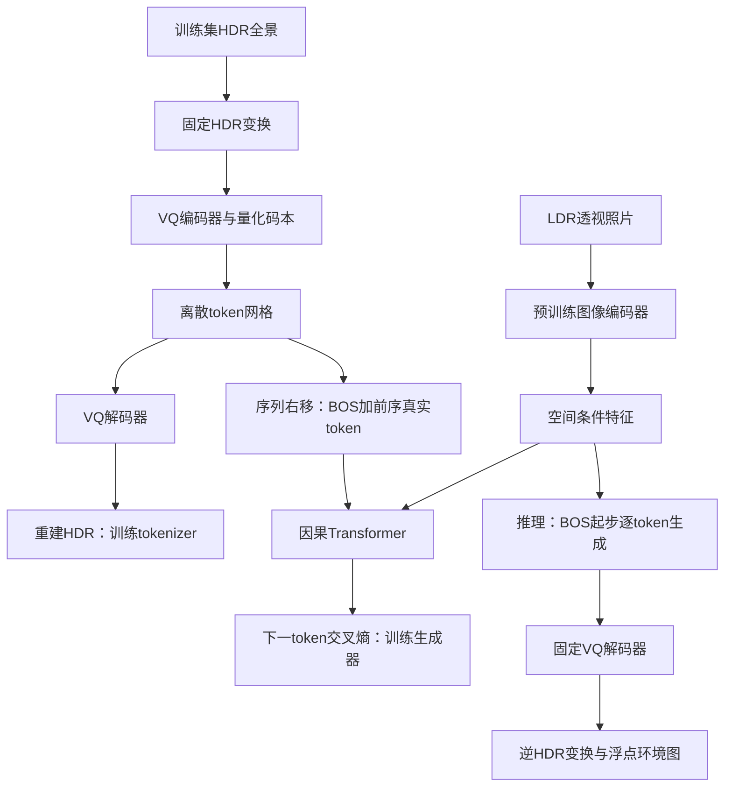

# 单张图像光照估计：需求、现状与实现方案

整理日期：2026-10-31。本文是待实现的工程方案，不是实验报告。依据当前项目源代码、父目录 `predict.py`、三份研究设想 DOCX，以及用户明确说明“没有做过 Laval 上的 token 化和 Transformer 训练”。未下载数据集，未训练或评测模型。

## 1. 当前项目到底做了什么

结论：已有一个启发式图像处理演示，但目标中的机器学习系统尚未实现；当前演示入口也存在语法错误，不能直接运行。

### 1.1 实际架构

```text
main.py
  ├─ utils.read_image_chinese_path：OpenCV 读取普通彩色图片
  ├─ utils.preprocess_image：缩放、BGR→RGB、除以255
  ├─ engine.LightingEstimator.estimate
  │    ├─ 全图平均颜色 × 0.5 → 背景色
  │    ├─ 95%亮度分位数阈值、连通域 → 候选亮区
  │    ├─ 启发式坐标映射、cv2.circle → 在全景画布上画光斑
  │    └─ 高斯模糊、逐行水平模糊、clip(0,1)
  └─ 保存8位PNG、Matplotlib显示
```

| 项目部分 | 核对结果 | 能说明什么 |
|---|---|---|
| 图像读写与预处理 | 有函数实现 | 可以复用其中文路径处理思路，但需修复冲突并另写HDR读写 |
| 启发式环境图 | 有源码 | 能根据图像亮区制作示意图，未证明恢复真实全景光照 |
| `src/utils.py` | 第1、64、127行有Git冲突标记；AST解析在第1行失败 | `main.py` 导入该模块即失败 |
| PyTorch模型 | `engine.py`仅导入torch，没有可训练网络 | 导入深度学习库不等于实现深度学习 |
| Laval数据集、划分、Dataset/DataLoader | 当前项目内未发现 | 数据准备尚无可核查交付 |
| tokenizer、码本、Transformer | 当前项目内未发现 | 核心方法尚未实现 |
| 训练、验证、checkpoint、实验配置 | 当前项目内未发现 | 没有训练完成的证据 |
| `inputs/`、`outputs/` | 检查时没有文件 | 当前目录没有可核查的输入输出样例 |
| 父目录 `predict.py` | 固定低通、高通、高斯卷积，再把灰度图缩放到全景尺寸 | 没有训练得到的CNN权重，也没有自回归生成 |
| 父目录指标表生成函数 | 对自身输出计算极值、方差、梯度等 | 只能描述输出，不能衡量预测相对真值的误差 |

现有实现还存在以下具体问题：

- 输出被限制在 `[0,1]` 并写为8位PNG，没有保留HDR线性辐射值；文件形状是2:1不代表恢复了360°光照。
- 亮物体、反射、高曝光区域都可能进入亮区检测，不能自动等同于光源。
- 二维坐标线性映射到固定经纬范围，没有相机内参或透视投影；视野外内容基本是常量背景。
- “物理衰减”实际是高斯模糊，没有求解辐射传输或建立距离衰减模型。
- `main.py`优先尝试父目录的`outputs/`，输出位置依赖目录存在情况；后续应统一使用明确配置路径。
- 父目录`predict.py`忽略输入参数，硬编码`exp1.jpg`，并输出灰度环境图。
- 该脚本所谓“动态范围”是最大值减最小值，所谓“阴影一致性”是自身梯度模长；两者均不是经过真值验证的光照准确性指标。

### 1.2 对旧材料的处理

旧材料中的“已复现Neural Illumination”“已安装渲染器”“已有A100服务器”“完成数据构建”等陈述，不能据文档文字认定为已完成。当前检查没有验证这些条件，用户已否认核心训练流程完成。将它们标为待核实或待实施，不用于描述项目进展。

旧材料还有推理跳步：因果注意力掩码不保证球面连续性或物理光照一致性；自回归概率分解也不是光线传播方程。GAN不是完成该任务的必需条件。首次性、精度提升、实时性等只能在文献核查和实验后提出。

## 2. 需求定义

### 2.1 核心需求

输入一张普通室内LDR透视RGB照片，输出一张完整360°的HDR环境光照图，用于给虚拟物体提供环境照明。模型根据可见图像线索预测可见与不可见方向的入射光分布，而非仅复制图像中的亮区。

首版将输出位置限定为拍照相机的光学中心。输出采用经纬展开ERP格式，固定相机朝向为全景中心的正前方；保存线性浮点`.hdr`（可扩展为`.exr`）和单独的色调映射PNG预览。

这是相对于旧报告“任意三维目标位置locale”的明确范围收缩，作为首版建议，后续如需保留原目标需单独扩展。任意位置光照涉及几何、遮挡、空间移动及对应位置真值，单个全景的透视裁剪不能提供这些监督。

### 2.2 功能需求与验收

| 功能 | 需要交付的能力 | 验收证据 |
|---|---|---|
| 数据准备 | 从HDR全景构造配对LDR透视图及对齐HDR目标 | 清单、投影参数、可视化配对、固定划分 |
| 环境图离散化 | 学习HDR适用的VQ tokenizer，完成编码与重建 | tokenizer权重、重建图、重建误差、码本使用情况 |
| 图像条件建模 | 从输入RGB提取空间特征供生成器读取 | 条件接口、预处理配置、条件有效性对照 |
| 自回归生成 | 不给真实目标token，仅由输入图像与已生成token逐步生成 | 独立推理脚本、完整生成结果、推理耗时 |
| HDR输出 | 保留大于1的数值及颜色，支持读回 | 浮点环境图、数值范围、格式往返检查 |
| 训练管理 | 训练/验证/断点续训、最优权重、配置和日志 | 固定划分下可复用的命令和产物 |
| 评估 | 与真实HDR及简单基线比较 | 测试集逐样本结果、汇总、失败案例 |
| 可视化 | 输入、真值、重建、生成结果、可选球体渲染 | 使用一致曝光和显示规则的对比图 |

单张照片不能唯一确定视野外的灯光，也不能在未知曝光下唯一恢复绝对辐射强度。因此首版学习条件分布与数据约定下的相对辐射尺度，不承诺唯一真实解或物理单位如lux。若以后需要绝对光度，应另行确认标定数据和曝光信息。

### 2.3 首版暂不纳入的扩展

任意三维位置的局部光照、几何token、深度与法线分支、Matterport3D多视图真值构建、GAN、FPGA部署、室外泛化、手机实时推理。这些在基础系统成立后再逐项决定，不能在首版没有闭环时全部叠加。

## 3. 方法选型

建议先实现“VQ-VAE环境图tokenizer + 图像条件自回归Transformer”。训练分两阶段：先学环境图的压缩和重建，再固定tokenizer，学习给定照片的token序列概率。

这一路线可参考[Taming Transformers的官方项目](https://github.com/CompVis/taming-transformers)，但首版采用无对抗损失的VQ-VAE，避免照搬旧训练依赖或把LDR预训练码本直接视作HDR码本。

这里的“视觉自回归”是逐token预测。它与[FoundationVision/VAR](https://github.com/FoundationVision/VAR)中特指的多尺度next-scale prediction不同。若项目明确要求复现该VAR范式，必须增加多尺度量化和尺度间生成，不能将下面的逐token方案写成已经实现该论文的方法。

### 3.1 训练与推理数据流



### 3.2 数据准备是第一项实际工作

首先确认所用的是哪一版Laval Indoor HDR、授权和下载方式、原始格式、是否有场景/房间分组及官方划分。当前没有验证数据实际可用数量，不把论文或网页数量当成本地已下载数量。[2017年原始工作](https://arxiv.org/abs/1704.00090)可作为任务与数据来源的起点；[数据入口](https://hdrdb.com/indoor/)本次访问超时，下载可用性和使用条款仍待核对。

构造训练样本时，从同一HDR全景按相机模型投影出有限视野透视图，再模拟曝光与相机响应获得LDR输入，原始HDR则提供相机位置的全景目标。

处理顺序和约定：

1. 在生成任何裁剪前按原始场景分组划分训练/验证/测试；有房间标识就按房间分组，没有则至少按全景分组并检查近重复。不能把同一全景的不同视角随机分散到不同集合。
2. 首版使用固定水平FOV（例如90°）及零俯仰、零滚转，目标全景绕竖直轴旋转到输入朝向为正前方。FOV是待验证的起始设置。改变视角时必须同步目标坐标，避免标签互相矛盾。
3. 通过针孔相机射线到球面方向进行采样，处理全景横向周期性，不能用矩形裁剪或简单拉伸替代透视投影。
4. 保存曝光参数和响应函数。输入可用固定、可复现的曝光压缩与sRGB变换作为起点；目标始终保留线性HDR。真实照片的相机处理差异需要后续验证。
5. 输入预处理遵循预训练编码器的均值方差，但避免默认中心裁剪悄悄改变已知FOV；使用明确的投影输出尺寸和缩放约定。
6. 不做独立的输入水平翻转或几何增广；必须同时更新对应HDR目标和坐标关系。曝光增广不能改变目标辐射值。
7. 清理非有限值、记录原始范围。HDR降采样在近似线性辐射域做面积过滤，并检查细小亮光源的能量损失。

数据清单至少记录：`scene_id, pano_path, split, yaw, pitch, roll, hfov, exposure, response_id, projection_version, target_rotation`。源数据只读，衍生数据和token缓存另存。

### 3.3 HDR变换与tokenizer

首版可采用 `X = log(1 + H / s)`，其中`H >= 0`，`s > 0`是仅根据训练集确定并写入配置的固定尺度；解码后使用 `H = s * expm1(max(X_hat, 0))`。输入输出参数必须完全一致。必要的数值上限依据训练集与数值精度设置并记录，不能无记录截断高光。

不要把每张目标单独除以最大值或均值而不保存尺度，那会丢失亮度信息。如果后续改成“形状归一化 + 尺度预测分支”，需明确训练该尺度分支及其不确定性。

VQ-VAE由卷积编码器、最近邻码本、卷积解码器组成。示例：`128×256`环境图经16倍下采样得到`8×16`网格，共128个离散token；码本先设512项，每项64维。数字是资源约束下的初始建议，不是已验证最优值。

首版重建目标：球面面积加权的对数HDR重建误差 + VQ码本项 + commitment项。经纬图第`y`行权重可取 `w_y = sin(pi*(y+0.5)/H)`，避免两极像素被过度计权。码本更新选择标准梯度法或EMA法之一，不能把两种更新混用。

卷积横向使用周期填充，纵向单独处理。周期填充和周期位置编码有助于处理接缝，但不会自动保证所有输出无缝；需实际比较边界邻域及重建误差，不能强制真实不同方向的边界像素完全相等。

先独立验证tokenizer能否保住光源位置、颜色、强度与积分能量，再训练Transformer。如果重建本身已经抹掉灯光，再好的token预测器也受该表示能力限制。

### 3.4 图像条件与自回归Transformer

图像编码器从TorchVision预训练ResNet-18起步，先冻结权重并设为评估模式，保留最后的空间特征图，投影到Transformer维度。冻结参数时也需固定BatchNorm行为。[TorchVision官方文档](https://docs.pytorch.org/vision/main/models)说明了预训练权重与预处理接口。

Transformer解码器对环境token做因果自注意力，对图像空间特征做交叉注意力。目标网格固定行优先展开；使用行列位置编码，列方向可用正余弦周期特征，显式记录全景正前方与上下方向。

```text
图像条件：c = ImageEncoder(I)
目标序列：z = [z1, z2, ..., z128]
训练输入：[BOS, z1, ..., z127]
监督目标：[z1, z2, ..., z128]
p(z | I) = Π_t p(z_t | z_<t, c)
训练损失：所有位置下一token交叉熵的均值
推理输入：只有I与BOS；生成满128项后结束并解码
```

训练时所有预测位置可通过teacher forcing并行计算；推理时逐项生成。需要检查右移和掩码没有泄漏当前/未来token；图像条件可以被所有目标位置访问。

生成时先用固定贪心策略获得可重复的主结果，再补充固定温度/top-k的多样本结果。不允许用测试真值从多个生成样本里挑最好结果，除非单独标明是oracle评估。

冻结tokenizer后，缓存目标token并训练Transformer。AR阶段先只优化交叉熵；对argmax/离散采样后解码图计算HDR或GAN损失，梯度不会自然传回token选择器。后续若做联合优化，需设计soft embedding、直通估计等路径并明确偏差，不能简单把损失相加宣称端到端可训练。

## 4. 初始配置和算力

现场`nvidia-smi`确认：NVIDIA GeForce RTX 5060 Laptop GPU，8151 MiB显存，驱动582.05。这只确认设备，不证明当前Python具备可用CUDA环境。

```yaml
# 建议写入未来configs/，当前只是方案示例，尚无训练入口可读取它
data:
  input_size: [224, 224]
  env_size: [128, 256]
  hfov_degrees: 90
  split_unit: scene
tokenizer:
  downsample_factor: 16
  codebook_size: 512
  embedding_dim: 64
  hdr_transform: log1p_fixed_scale
autoregressive:
  layers: 6
  d_model: 256
  heads: 8
  sequence_length: 128
  image_encoder: resnet18_pretrained_frozen
training:
  seed: 42
  optimizer: AdamW
  tokenizer_lr: 0.0002
  ar_lr: 0.0001
  micro_batch_size: 2
  gradient_accumulation_steps: 8
  amp: true
  grad_clip_norm: 1.0
```

上述配置要先测单步前向、反向、峰值显存和耗时，之后再确定batch size、训练长度及最终分辨率，不预先承诺8GB显存可跑完整实验或训练所需天数。单独训练两个阶段、冻结编码器、缓存token有助于控制资源。

## 5. 需要准备的库和外部资源

### 5.1 软件依赖

| 类别 | 库/工具 | 用途与取舍 |
|---|---|---|
| 运行环境 | Python，建议单独建3.11或3.12环境 | 与其他研究环境隔离；最终以所选PyTorch支持范围为准 |
| 核心必需 | `torch`, `torchvision` | 网络、训练、混合精度、预训练图像编码器；VQ与Transformer先用原生PyTorch实现 |
| 数组/图像必需 | `numpy`, `opencv-python`, `Pillow` | 数组、透视投影、普通图像读写和Radiance HDR编解码 |
| 实验管理必需 | `PyYAML`, `tqdm`, `matplotlib` | 配置、进度与可视化；指标先存JSON/CSV |
| 检查工具 | `pytest` | 数据几何、掩码、HDR往返等关键行为检查 |
| 推荐但非必需 | `tensorboard` | 本地训练曲线；可后加，避免增加首轮安装复杂度 |
| 按需 | `OpenEXR`或`imageio`及对应插件 | 数据确实含EXR时增加；安装imageio本体不保证EXR解码可用 |
| 后续选装 | `mitsuba`, `kornia`, `timm`, `wandb` | 分别用于高级渲染、几何算子、更多视觉编码器、远程日志；首版不依赖 |

不需要为这一任务安装大语言模型或`transformers`库；它不是实现自回归Transformer的必需依赖。首版也不需要PyTorch3D、FlashAttention、GAN训练框架或FPGA工具链。

GPU版`torch`和`torchvision`按[官方安装选择器](https://pytorch.org/get-started/locally/)选择Windows、Pip及支持本机架构的CUDA构建，安装匹配版本。PyTorch已提供[Blackwell相关支持说明](https://pytorch.org/blog/pytorch-2-7/)，但具体Windows wheel仍需实测。不要直接照搬旧仓库的CUDA/PyTorch版本。

安装验收要实际完成GPU张量运算、一次网络前向/反向，以及HDR写入读回。`nvidia-smi`正常或`torch.cuda.is_available()`为真都不足以代替实际算子运行。环境通过后再导出锁定依赖。

现场仅检查到的解释器为`C:\Users\lenovo\AppData\Local\Programs\Python\Python313\python.exe`；该解释器中有NumPy、OpenCV、Pillow，未发现torch、torchvision、Matplotlib等包。此结论仅针对该解释器，不代表电脑所有Conda/虚拟环境都没有这些库。

### 5.2 必须准备的资源

| 资源 | 当前状态 | 下一步 |
|---|---|---|
| Laval Indoor HDR原始数据与使用许可 | 未在当前项目发现；尚未验证下载 | 确认具体版本、获取方式、格式和划分 |
| ResNet-18预训练权重 | 当前未验证本地存在 | 从TorchVision官方渠道下载并记录权重标识 |
| 模型方法参考 | 已确认官方VQ/AR及VAR代码入口 | 参考接口与思想，不直接认定适用HDR |
| 磁盘预算 | 未测量原始数据体积 | 根据实下载原件、降采样、token缓存和权重估算；无依据要求15TB NAS |
| 实验记录 | 尚无完整闭环记录 | 保存数据清单、配置、环境、权重和逐样本结果 |

## 6. 建议的代码结构

以下为待建目录；现有`main.py`、`src/engine.py`不能当作这些模块已完成。

```text
Lighting_Estimation_Project/
  docs/项目需求与实现方案.md
  configs/{data,tokenizer,ar,baseline}.yaml
  scripts/
    prepare_data.py          # 场景划分、透视样本、配对与预览
    train_tokenizer.py       # 环境图重建训练
    cache_tokens.py          # 固定tokenizer版本后缓存标签
    train_ar.py              # 条件序列训练
    train_baseline.py        # 简单连续回归基线
    evaluate.py             # 统一评测协议
    predict.py              # 单图独立推理
  src/
    data/{dataset,projection,hdr_io}.py
    models/{vqvae,quantizer,image_encoder,ar_transformer,baseline}.py
    training/{loops,checkpoint}.py
    evaluation/{metrics,render_sphere}.py
    utils/{config,seed,visualization}.py
  tests/
  data/{raw,processed,splits,tokens}/
  runs/<run_id>/{config.yaml,checkpoints,metrics,previews}/
```

现有`src/utils.py`与未来`src/utils/`同名，需要在实施时先迁移或重命名，避免导入冲突。模块接口以批量`B×C×H×W`为主；tokenizer返回`B×8×16`整数索引，AR返回`B×128×512` logits。缓存必须绑定数据版本、HDR变换、码本checkpoint哈希和展开顺序，tokenizer变化后重新生成缓存。

## 7. 实施顺序与完成标准

| 阶段 | 具体工作 | 什么才算完成 |
|---|---|---|
| P0 现有工程整理 | 解决utils合并冲突、整理旧演示、统一路径、搭建并验证环境 | 旧演示可启动，GPU前后向和HDR读写通过；仍不能称核心方法完成 |
| P1 数据闭环 | 下载并检查数据、先划分后裁剪、固定坐标与曝光、构造配对Dataset | 可视化输入朝向和目标正确，集合无源全景泄漏，清单可重建 |
| P2 tokenizer | VQ-VAE训练、重建评测、码本统计、权重和token缓存 | 重建光照有可核查质量，未出现只用极少数码字的坍塌；结果及不足有记录 |
| P3 AR模型 | 图像条件、因果掩码、训练循环、续训、纯生成推理 | 小集合能拟合，独立推理不依赖目标token；保存可载入checkpoint |
| P4 对照验证 | 简单回归基线、去图像条件对照、固定测试集评测与球体渲染 | 生成误差、渲染结果、耗时均有真实数据；允许结论是AR没有优势 |
| P5 质量提升 | 按主要失败原因改分辨率、码本、球面处理或条件编码 | 每项改动有与原版一致协议的对照，不把增加模块本身作为成果 |

依赖关系：`P0 → P1 → P2 → P3 → P4 → P5`。连续回归基线可在P1完成后与P2独立推进。渲染工具也可在数据约定明确后独立开发。

小样本拟合用于排查训练逻辑，不能证明模型泛化。一个完整的测试集结果也不能自动证明新颖性。真实实验失败仍属于有效进展，应保留记录，不编造达标指标。

## 8. 评估协议

至少保留以下对照：训练集平均环境图（使用相同尺度与坐标约定）；图像编码器加连续卷积解码器的回归模型；无图像条件或打乱图像条件的AR对照；完整条件AR。旧启发式演示可补充展示，但其输出没有同等HDR尺度，不能充当唯一主基线。

| 指标/检查 | 目的与限制 |
|---|---|
| 球面加权log-HDR MAE/RMSE | 评价辐射分布，明确HDR变换与固定尺度 |
| 球面加权线性HDR RMSE | 对高能量光源更敏感，与log误差并列 |
| 尺度对齐误差 | 仅消除一个正的全局乘数，评价分布形状；同时报告未对齐结果，不能隐去强度错误 |
| 最亮区域方向角误差 | 检查方向，但多灯或漫射场景需注明局限，不单独据此排名 |
| 漫反射/粗糙镜面球渲染误差 | 固定相机、材质、曝光、色彩管理；与真值环境的相同渲染比较 |
| tokenizer码本使用与重建 | 区分表示瓶颈与AR预测问题，不把token准确率当最终光照质量 |
| 条件有效性检查 | 打乱输入后性能应有可解释变化，检查模型是否忽略照片 |
| 延时与显存 | 固定硬件、分辨率、batch=1，GPU计时需同步并记录预热规则 |

首版可用线性环境图积分实现漫反射球与简单镜面反射预览，之后再接Mitsuba等渲染器。不把FID作为首要光照指标，也不把自身图像方差、梯度或视觉“更好看”等同于真实光照准确。

评估使用未见场景。所有模型采用相同划分、方向和曝光规则，测试集不用于选配置。报告验证选择规则、逐样本误差及失败图；样本量允许后，再考虑多个随机种子的稳定性。

## 9. 最终需要交付的东西

项目完成时应能交付：可复用环境和安装说明；来源可核查的数据清单与划分；数据准备、两阶段训练、评测和单图推理入口；tokenizer与AR权重；记录实际结果的测试报告；一组包含输入、真值、预测HDR和渲染对照的样例。

当前可以准确描述为：“已整理单图光照估计需求，现有代码为启发式演示，拟采用HDR环境图离散化与图像条件自回归生成方案，数据准备、模型训练及真实评估尚待实施。”
